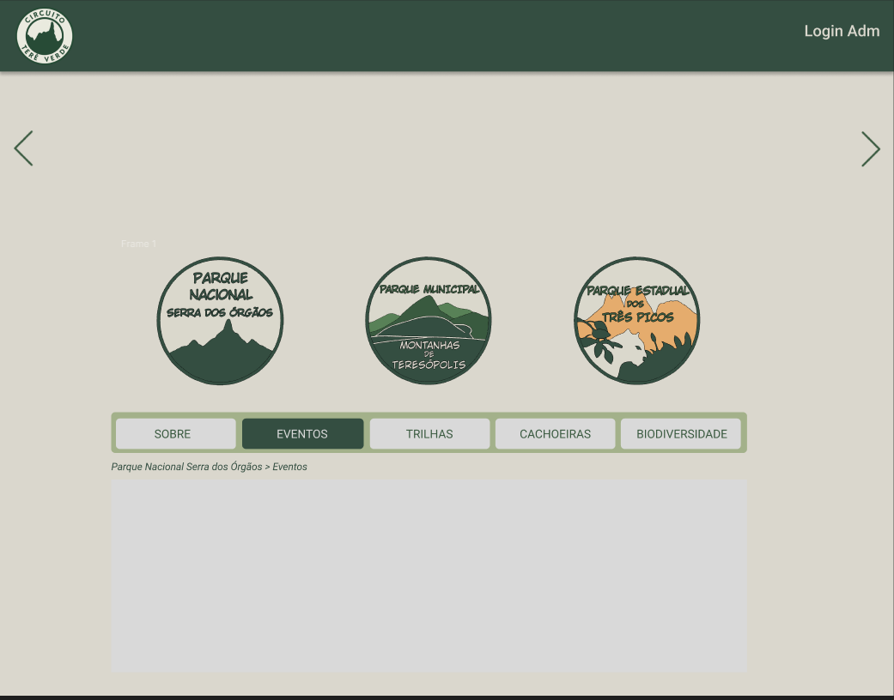
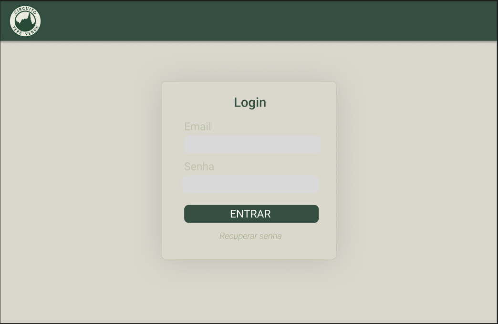
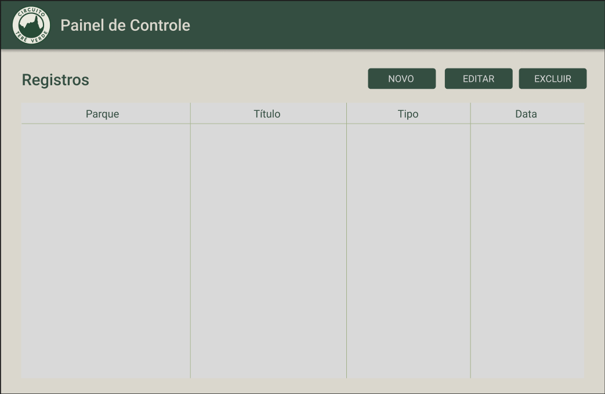
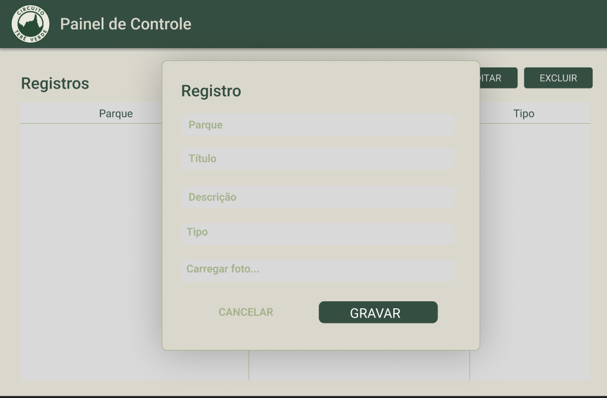

# Circuito Terê Verde — Frontend


## Apresentação

O Frontend do Circuito Terê Verde foi desenvolvido como a interface web do MVP, reunindo páginas e recursos para apresentar os parques e seus conteúdos de ecoturismo. A página principal exibe postagens com filtros por parque e categoria, enquanto a página “Sobre” apresenta informações das unidades de conservação. Também foram criadas telas de login e um painel administrativo para visualizar e simular o cadastro e a edição de postagens.

A navegação entre essas telas permite demonstrar como visitantes podem explorar os conteúdos e como administradores podem organizá-los. Nesta versão, as postagens e o login do Frontend usam dados simulados.

## Funcionalidades previstas

- Apresentação dos parques e de informações sobre cada unidade de conservação.
- Exibição de postagens sobre trilhas, cachoeiras, biodiversidade, eventos, novidades e atrações.
- Filtros para ajudar visitantes a encontrar conteúdos de interesse.
- Telas de acesso e de administração para demonstrar a publicação e manutenção dos conteúdos.
- Interface planejada para consulta em diferentes tamanhos de tela.

## Protótipos

As telas foram planejadas no Figma e serviram como referência para a construção do Frontend.

[Acessar o protótipo no Figma](https://www.figma.com/design/8h9bIUN2wJT7pQEnlBlgL0/Circuito-Tere-Verde?node-id=0-1&t=ZuovEVVD7DJLBvDC-1)

### Página principal



### Login



### Painel administrativo



### Cadastro



## Requisitos do Frontend

Os requisitos funcionais e não funcionais do Frontend estão disponíveis na [planilha de requisitos](../requisitos/Requisitos_Frontend.xlsx).


## Tecnologias Utilizadas

- **Vite** — Utilizado como bundler e servidor de desenvolvimento para garantir builds rápidas e um ambiente leve durante o desenvolvimento.
- **React** — Utilizado para estruturar toda a interface do site por meio de componentes funcionais.
- **Tailwind CSS** — Usado para estilizar o projeto com classes utilitárias, mantendo o layout rápido de ajustar e responsivo.
- **Lucide React** — Utilizado para inserir ícones leves e consistentes em diferentes partes da interface.
- **Embla Carousel** — Implementado para criar o carrossel de forma simples, fluida e totalmente integrada aos componentes do React.

## Como executar

Para visualizar o Frontend localmente, é necessário ter o Node.js instalado. No terminal, a partir da pasta `Frontend`, execute:

```bash
npm install
npm run dev
```

O terminal indicará o endereço para abrir no navegador, normalmente `http://localhost:5173`.


## Materiais do projeto

- [README principal do Circuito Terê Verde](../README.md)
- [Documentação do Backend](../Backend/README.md)
- [Apresentação do MVP](../Apresentação/Apresentacao_MVP.pptx)
